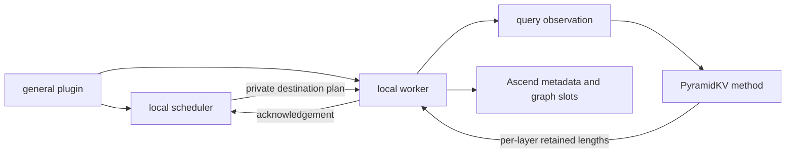

# PyramidKV-owned host contract

The integration entry point is `vllm.general_plugins:ascend_pyramidkv`, resolving
to `vllm_ascend_pyramidkv:register`. Registration is explicit/default-off and
idempotent. The disabled entry point needs neither vLLM nor PyTorch. The adapter
uses checked host hooks because the supported vLLM/Ascend pair has no public
transactional compression API. Those hooks belong to PyramidKV and never call
or import KVCompress. The local contracts are internal, not a new shared API.

## Ownership

| Module under `vllm_ascend_pyramidkv` | Responsibility |
| --- | --- |
| `adapter/config.py` | Direct/Manager activation, strict local config, conflicting mutation guard |
| `adapter/contracts.py`, `adapter/transaction.py` | Shape, cache, query and result types; private-block plans and shared active anchors |
| `adapter/plugin.py` | Scheduler/runner/attention/slot hooks and lazy worker loading |
| `adapter/scheduler.py` | Allocation, APC admission, commit barrier, deferred free, abort/preemption |
| `adapter/worker.py` | Cache binding, query capture, compression and commit orchestration |
| `adapter/metadata.py` | Physical offsets, semantic length snapshots, native/batched layer slots, FULL capture and MTP metadata |
| `adapter/host_validation.py` | Shared host/layout/runtime checks without importing scheduler or worker implementations |
| `adapter/host_compat.py`, `adapter/host_worker.py`, `adapter/qwen_gdn_ops.py` | Exact host ABI bridges and missing GDN output operation |
| `method.py` | Query ring buffers, transaction identity, selected-page materialization |
| `algorithm.py` | Host-independent configuration, scoring, GQA reduction, pooling and layer budget schedule |

`AttentionMetadata` receives the worker's active-request mapping by reference;
commit and reset mutate that mapping in place. It owns all metadata buffers and
replaces them together when binding a new runner/cache. Worker hook methods are
an explicit facade for this component. Native and batched paths share the same
per-layer offset calculation. The scheduler imports validation and transaction
values directly, without loading the worker implementation.

Version 0.4 removes the historical schema-v1 provider/runtime, registry and host
contract fallback. The current JSON configuration's `schema_version: 1` remains
supported. Algorithm consumers use `PyramidKVConfig` and selection functions in
`algorithm.py`; there is no legacy runtime compatibility shim.

The owned adapter derives from shared commit
`f33785844be5bff7716c9464dd8444ef0b4b05e9`; PR33's subsequent documentation commits
do not change those runtime bytes. There is no TriAttention factory, external
method discovery, calibration or TriAttention kernel import in this package.
The generic physical-position subtraction is local PyTorch code.

## Invariants

- Compression admission remains strictly above the configured prompt threshold.
  Final-prefill query tails span chunks; APC leaves the required suffix for
  recomputation. An incomplete or mismatched observation fails closed.
- Scheduler source blocks remain immutable and may be shared through APC. The
  worker writes private destination blocks. Scheduler and worker commit only at
  the acknowledged transaction boundary; asynchronous in-flight blocks are freed
  after the required barrier. Compacted KV never receives semantic prefix hashes.
- RoPE and Mamba retain semantic positions. Full attention consumes physical
  lengths; each layer can retain a different budget. The first target layer's
  selection materializes the auxiliary MTP cache, as before.
- Graph slots are allocated before capture and updated in place; query observation
  runs at the attention custom-op boundary. Synthetic capture rows, empty async
  steps and rejected draft tokens preserve the original mapping rules.
- The opt-in batched metadata path owns immutable correction tensors and stable
  slot storage. Unsupported layouts take the native slot-mapping path. Metadata
  tensors follow the host's device rather than assuming sequence lengths are NPU.
- Abort, completion and preemption discard request observations/state. Rebinding
  the method's cache clears prior query/completion slots; worker reinitialization
  constructs a fresh provider before binding. Live graph hot swapping is unsupported.

See [the audit/design](superpowers/specs/2026-11-02-standalone-adapter-design.md),
[support matrix](support-matrix.md), and [validation protocol](standalone-validation.md).
